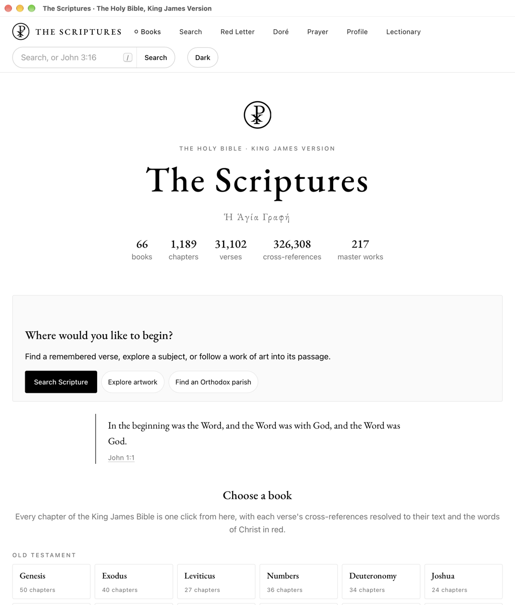
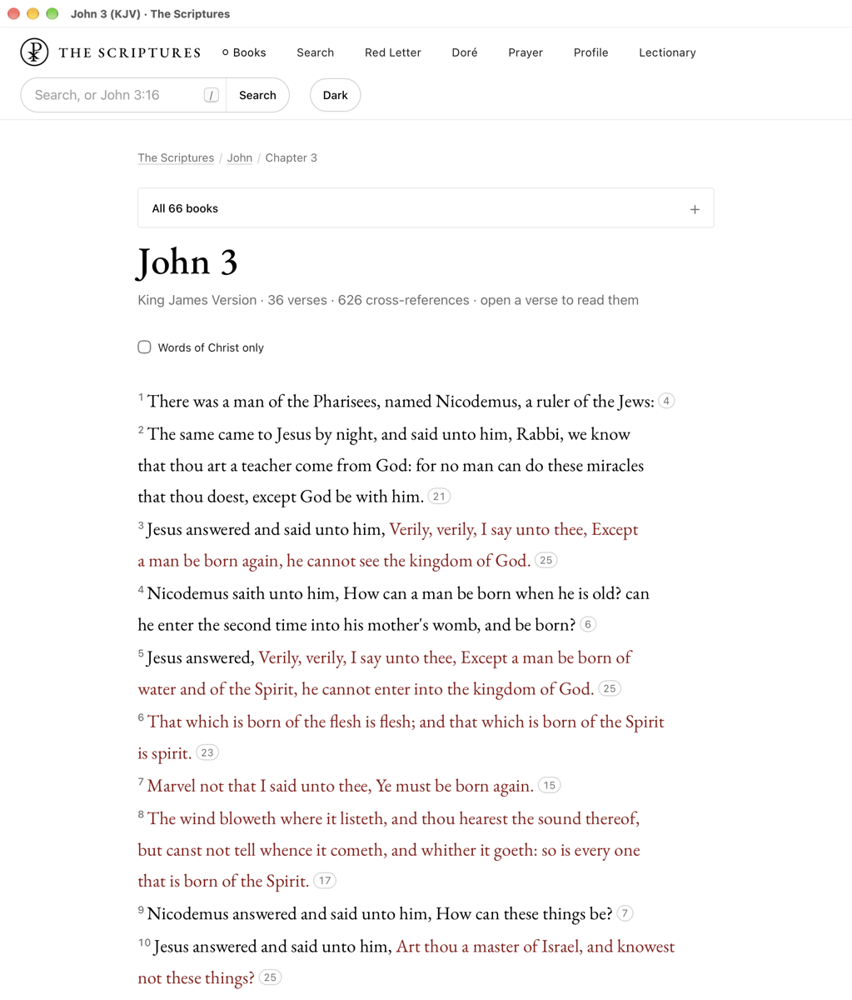
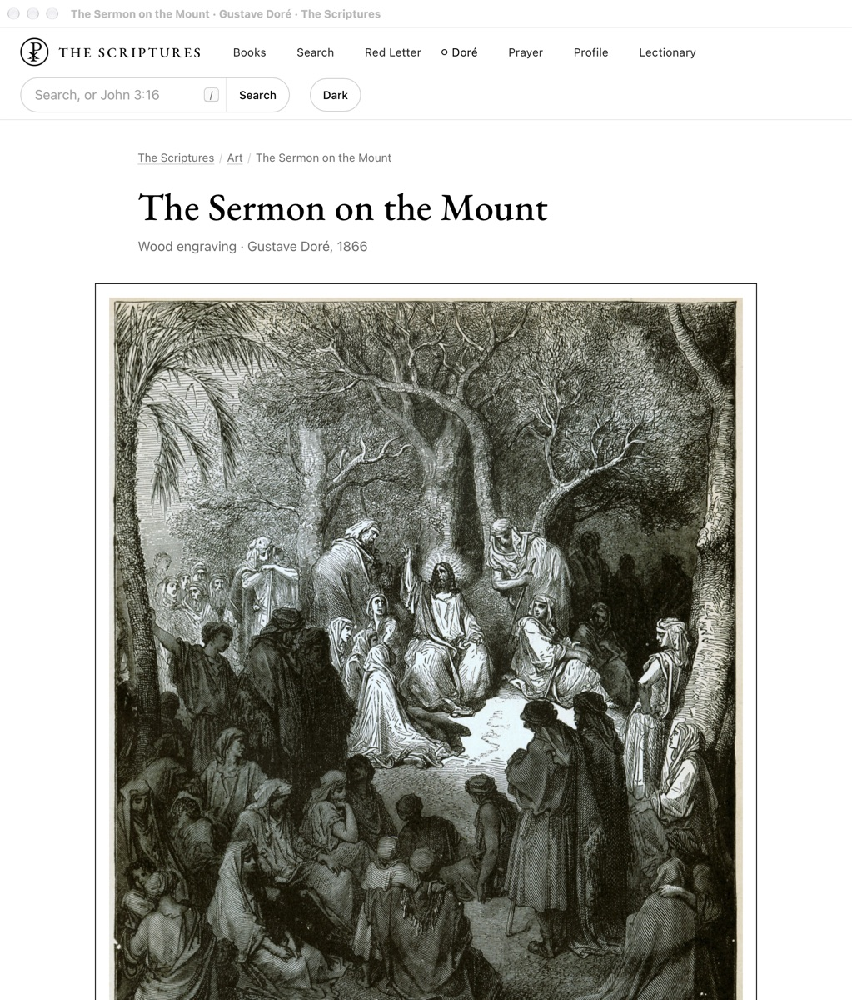
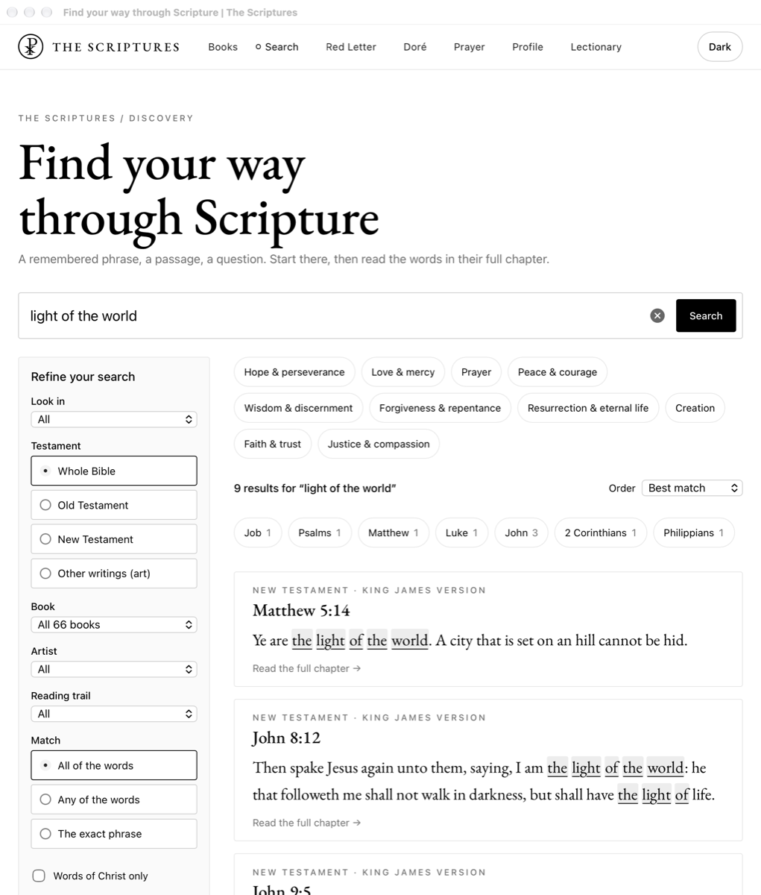

# The Scriptures

**The King James Bible with the master engravings: free, offline, open source.**

Α ☧ Ω

Dedicated to **JESUS CHRIST**, who is God; all of it is from Him (John 15:5).
Given freely, to the glory of God, for every nation.

> *"freely ye have received, freely give."* - Matthew 10:8, KJV

Read it online at **[scriptures.goroshillc.com](https://scriptures.goroshillc.com)**, or install the
app for Windows, macOS and Linux and read it with no connection at all.



## What it is

- **The whole King James Bible**: 66 books, 1,189 chapters, every chapter its own page.
- **Cross-references resolved to their text**: the Treasury of Scripture Knowledge, shown beside
  each verse, so a reference can be read without leaving the chapter.
- **The words of Christ in red**, from the eBible.org red-letter edition, and a words-of-Christ-only
  reading.
- **217 public-domain master engravings and paintings** by Gustave Doré, Albrecht Dürer and Titian,
  each placed at its passage and shown in the order of the Bible, with a zoom view of the full scan.
- **Search** of every verse and plate, with references typed straight in (`John 3:16`, `Ps 23`) and
  King James spellings found from modern ones (`show` finds `shew`).
- **The Orthodox lectionary**, Pascha for any year, a prayer rule, and a private reading record
  that stays on your own computer.
- **No accounts, no tracking, no requests to anyone.** The app opens no port and makes no network
  request; the website loads nothing from any other site.

| Reading | A plate | Search |
| --- | --- | --- |
|  |  |  |

## Download

Get the newest release from **[Releases](https://github.com/goroshillc/scriptures/releases)**:

| System | File |
| --- | --- |
| Windows 10 and 11 | `Scriptures_<version>_x64-setup.exe` (or the `.msi`) |
| macOS 11 or newer (Apple silicon and Intel) | `Scriptures_<version>_universal.dmg` |
| Linux | `Scriptures_<version>_amd64.AppImage`, `.deb` or `.rpm` |
| Arch Linux | the `PKGBUILD` attached to the release (from [`packaging/arch`](packaging/arch)) |

The installers are about half a gigabyte: every page and every plate is inside, so nothing is
downloaded later.

The apps are not yet signed with a paid publisher certificate, so the first launch asks once:

- **macOS**: open the app, then System Settings, Privacy & Security, **Open Anyway**.
- **Windows**: on the SmartScreen notice choose **More info**, then **Run anyway**.

## Wallpapers

Every plate centred on white, numbered in the order of the Bible, at 1920 x 1080, 2560 x 1440,
2560 x 1600 and 3840 x 2160. Download `scriptures-wallpapers-<size>.zip` from the release.

**Omarchy**: unzip, then copy the images into your theme's background folder and press
**Super + Ctrl + Space** (or run `omarchy theme bg next`):

```sh
theme=$(cat ~/.local/state/omarchy/current/theme.name)
mkdir -p ~/.config/omarchy/backgrounds/$theme
cp scriptures-wallpapers-3840x2160/*.jpg ~/.config/omarchy/backgrounds/$theme/
```

The plates sit on white, so they suit Omarchy's White theme best. On any other system, set any
image as the desktop background. `CREDITS.txt` in each folder names every plate and its source.

## Build from source

Everything is Rust, built with the exact stable release pinned in `rust-toolchain.toml`.

```sh
# Rust (https://rustup.rs), then:
rustup toolchain install    # reads rust-toolchain.toml (Rust 1.99.0, wasm32 target)
scripts/check.sh            # format, lints and every test (needs Deno for the browser glue)
```

**The reader** (needs Node.js for the search parity check):

```sh
scripts/art-pack.sh fetch                      # the desktop edition's plates (about 0.5 GB), sha256-checked
scripts/build-site.sh desktop dist-desktop     # build, crawl every link, check search in Rust and WASM
```

For the website's full edition (AVIF, WebP and JPEG at every width), fetch the art from its source
instead: `scripts/fetch-art.sh` downloads each plate's Commons original, refuses any whose sha1
differs from the reviewed file, and derives every size (needs `cjpeg`, `cwebp` and `avifenc`). Then
`scripts/build-site.sh web dist-web`.

**The app** (Tauri 2; see Tauri's [prerequisites](https://v2.tauri.app/start/prerequisites/) for your
system):

```sh
cargo install tauri-cli --version 2.12.1 --locked
scripts/art-pack.sh fetch
scripts/build-app.sh                  # every installer this system can make
scripts/build-app.sh --bundles app    # or just the app
```

On Debian or Ubuntu the app needs
`libwebkit2gtk-4.1-dev build-essential curl wget file libxdo-dev libssl-dev libayatana-appindicator3-dev librsvg2-dev`;
on Arch, `webkit2gtk-4.1 base-devel curl wget file openssl appmenu-gtk-module libappindicator-gtk3 librsvg xdotool`.

**The wallpapers**: `scripts/wallpapers.sh OUT_DIR` (needs the Commons originals from
`scripts/fetch-art.sh` and `cjpeg`).

## How it is made

| Crate | What it does |
| --- | --- |
| [`crates/scriptures`](crates/scriptures) | `goroshi-scriptures`: fetches and checks the sources, builds every page, crawls the result, makes the wallpapers |
| [`crates/scripture-search`](crates/scripture-search) | search, references and the private reading record, in Rust, compiled to WebAssembly for the browser |
| [`crates/scriptures-host`](crates/scriptures-host) | the website's static host: read-only, its own Content-Security-Policy, no cookies read |
| [`crates/scriptures-app`](crates/scriptures-app) | the desktop app: the system webview (Tauri 2) answering a private `scriptures:` scheme through the same host |
| [`crates/chi-rho`](crates/chi-rho) | the emblem: the Chi Rho from Junicode (SIL Open Font License) within one circle |

Every page is plain HTML that reads with scripting off; the small amount of JavaScript is browser
glue only, and every rule (search, ranking, the reading record) is the same Rust code in the build
and in the browser. Where every input came from is in [SOURCES.md](SOURCES.md) and
[PROVENANCE.md](PROVENANCE.md).

## Contributing

Christians, and anyone who wants to help, are welcome. Read [CONTRIBUTING.md](CONTRIBUTING.md): the
King James text stays word for word, the art is public-domain master work only and never generated,
and every image is looked at one by one before it is admitted. Please follow the
[Code of Conduct](CODE_OF_CONDUCT.md).

## Licence

- **Code, site text and design**: MIT or Apache-2.0, at your option ([LICENSE-MIT](LICENSE-MIT),
  [LICENSE-APACHE](LICENSE-APACHE)).
- **The King James Version**: public domain (in the United Kingdom the Crown holds rights to it).
- **The art**: public domain; each work's Wikimedia Commons source and licence is in
  [SOURCES.md](SOURCES.md). No copyright is claimed in it.
- **Cross-references**: Treasury of Scripture Knowledge via [OpenBible.info](https://www.openbible.info/labs/cross-references/),
  CC BY 4.0.
- **Lectionary dates**: [orthocal.info](https://orthocal.info/) (MIT).
- **Fonts**: EB Garamond and Junicode, SIL Open Font License 1.1 (the licence texts ship beside them).

© 2026 Stefano Theofanous and Goroshi LLC.
